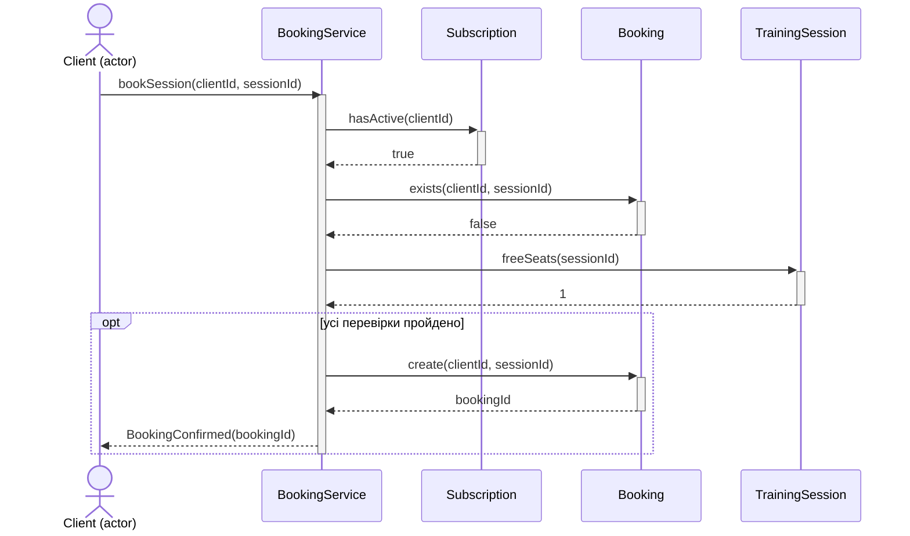
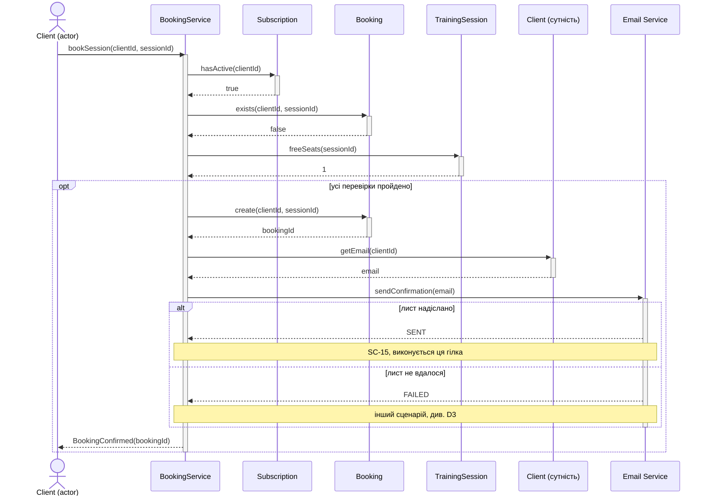
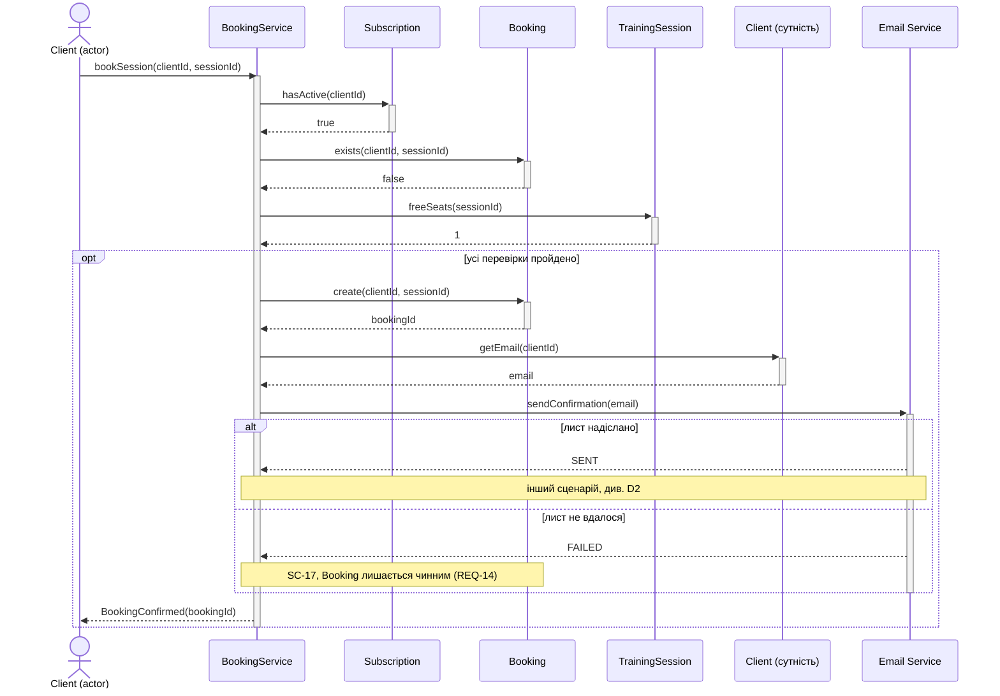
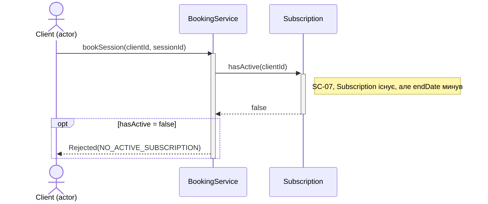
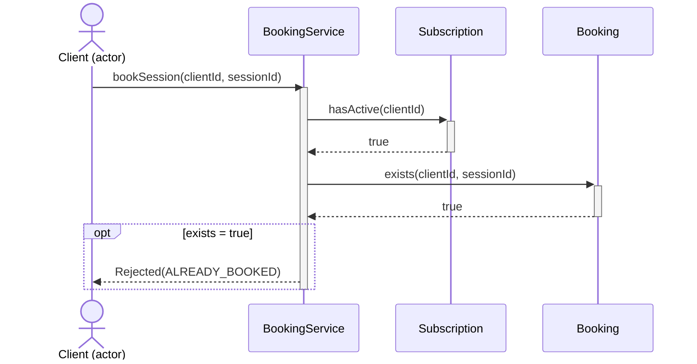
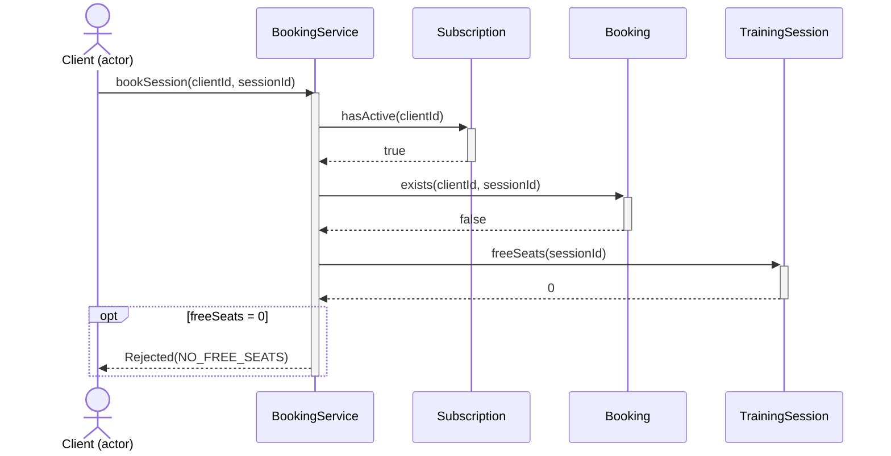

**D1 (SC-05): Запис створено**

**D2 (SC-15): Запис створено, лист надіслано**

**D3 (SC-17): Запис створено, лист не вдався, Booking лишається**

**D4 (SC-06): Відмова, у клієнта немає жодного Subscription**

**D5 (SC-07): Відмова, Subscription прострочений**

**D6 (SC-09): Відмова, повторний запис**

**D7 (SC-08): Відмова, немає вільних місць**

